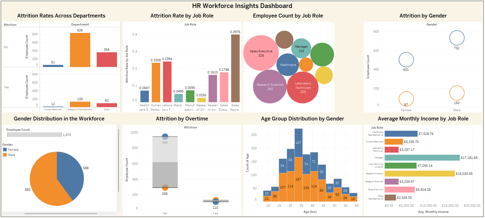
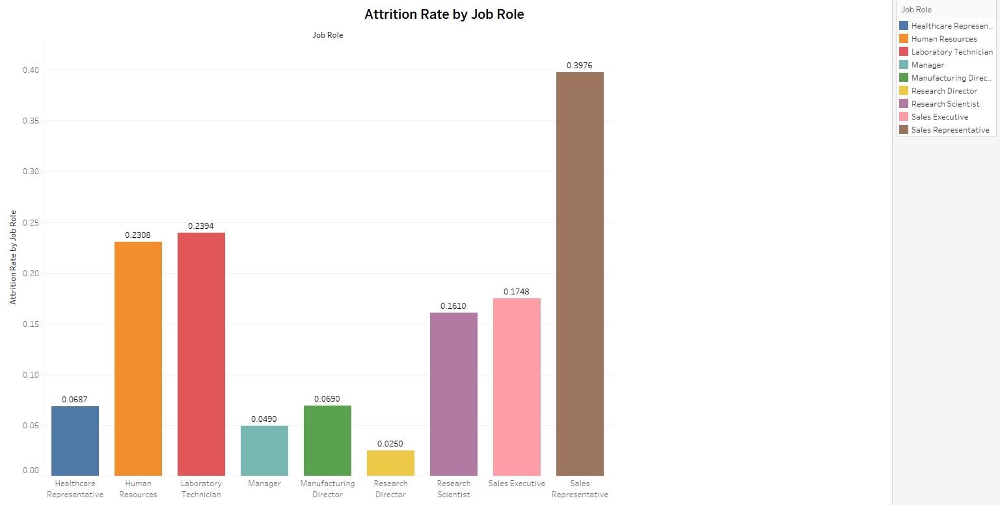
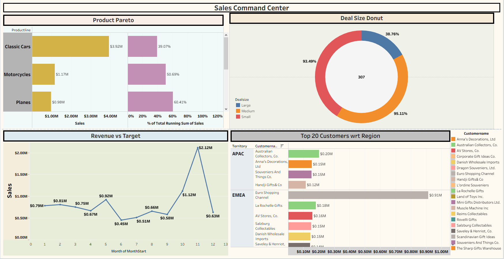

# Interactive Sales & HR Analytics Dashboards (Tableau)

Two interactive Tableau dashboards built for my MSc Data Analytics (BSBI, Berlin).

## HR Workforce Insights Dashboard (`hr_attrition_dashboard.twb`)
**[View the live dashboard on Tableau Public](https://public.tableau.com/app/profile/riddhi.aggarwal5471/viz/HRWorkforceInsights_17948424067070/Dashboard1)**




**Question:** where is the company losing employees, and what does the workforce look like?

**Data:** *IBM HR Analytics Employee Attrition & Performance* (Kaggle), 1,470 employees

**What I built:** 8 linked views covering attrition by department, job role, gender and overtime, plus age, gender and income breakdowns. They're combined into one dashboard for HR leaders.

**Custom metric: attrition rate by job role.** I wrote this calculated field myself:
```
SUM(IF [Attrition] = "Yes" THEN 1 ELSE 0 END) / COUNT([EmployeeNumber])
```



**Key findings**
- **Sales Representatives have by far the highest attrition: about 40%** leave, compared with 2.5% of Research Directors and 4.9% of Managers.
- Laboratory Technicians (24%) and HR staff (23%) are the next most at-risk roles.
- By department, Sales (20.6%) and Human Resources (19.0%) lose more people than R&D (13.8%).
- The roles with the highest attrition are also the lowest paid. Sales Representatives earn the least on average (about 2,600/month), while Managers earn about 17,200/month and Research Directors about 16,000/month. The dataset gives no currency.
- **Overtime is the strongest warning sign:** 30.5% of employees who work overtime leave, compared with 10.4% of those who don't.
- The workforce is 60% male. Attrition is slightly higher for men (17.0%) than for women (14.8%).

**Recommendation:** focus retention efforts on entry-level, lower-paid roles (Sales Representatives and Lab Technicians), for example through pay reviews and clearer progression paths, and keep an eye on overtime.

## Sales Command Center (`sales_dashboard.twb`)
**[View the live dashboard on Tableau Public](https://public.tableau.com/app/profile/riddhi.aggarwal5471/viz/SalesCommandCenter/SalesCommandCenter)**



**Question:** is the company hitting its revenue targets, and which products, customers and regions drive sales?

**Data:** *Sample Sales Data* (Kaggle), order-level sales of model cars, motorcycles, planes and other product lines

**What I built:** a single dashboard for a VP of Sales and regional managers, with four linked views and filters:
- **Revenue vs Target:** monthly sales trend
- **Product Pareto:** revenue by product line, with the running % of total
- **Deal Size Donut:** mix of small, medium and large deals
- **Top 20 Customers by Region:** drill-down from territory to customer

**Key findings**
- **Classic Cars is the dominant product line**, at $3.92M, about 39% of all sales.
- Sales peak sharply in **November** in both 2003 and 2004 (about $1.0–1.1M each year, compared with $0.2–0.5M in most other months). That points to a strong seasonal pattern before the holidays.
- **Euro Shopping Channel** (EMEA) is the biggest customer, at $0.91M, followed by Mini Gifts Distributors (North America) at $0.65M. No other customer reaches $0.25M, so revenue depends heavily on these two accounts.

*Note: the targets are illustrative, because the dataset contains no real sales quotas.*

## How to open
Open the `.twb` files in Tableau Desktop or Tableau Public. When Tableau asks for the data, point it to the Kaggle dataset (the data files are not included).

**Tools:** Tableau, calculated fields, KPI design, data storytelling
